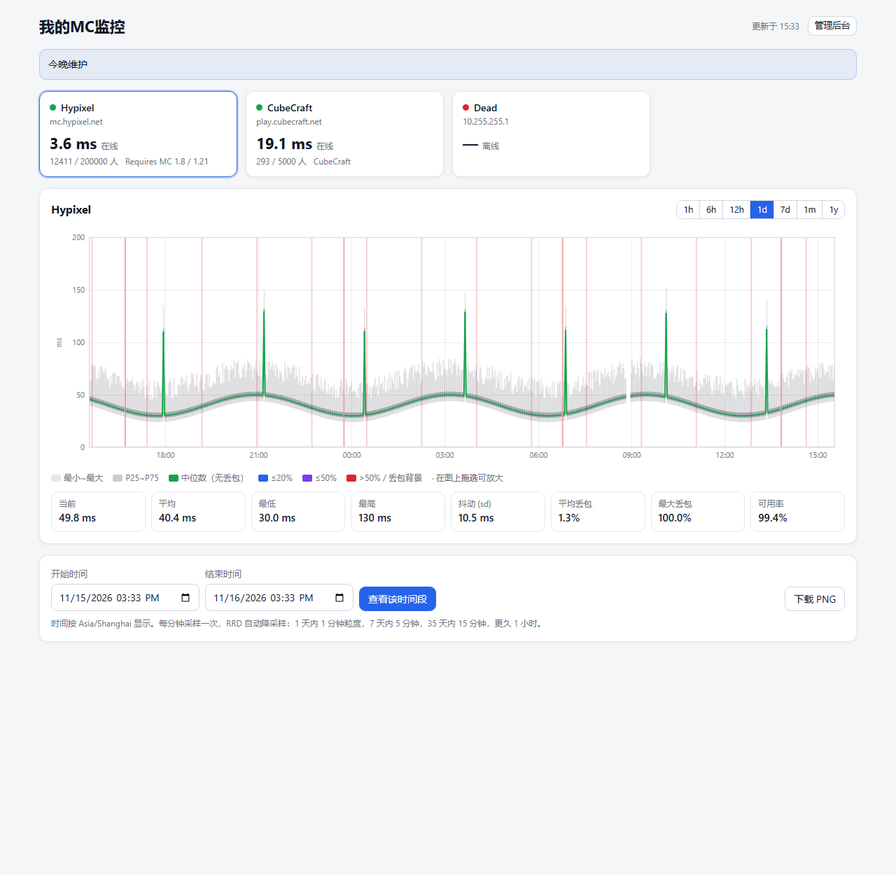
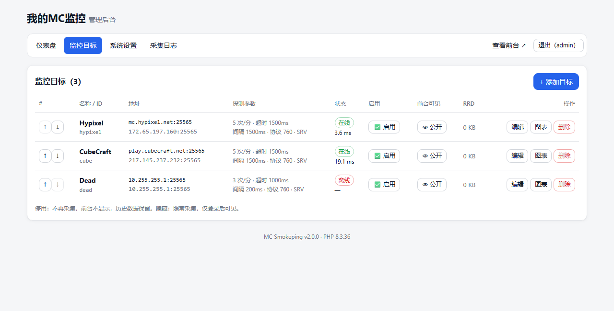
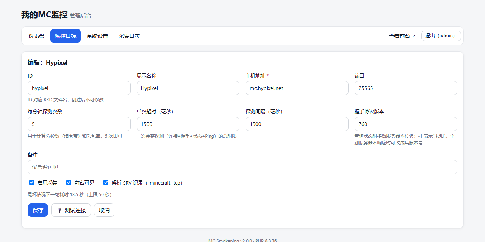

# MC Smokeping

Smokeping 风格的 **Minecraft Java 版服务器延迟 / 丢包监控**，纯 PHP，零前端依赖，自带管理后台。

- 每分钟对每个服务器做多次 Server List Ping，记录最小 / P25 / 中位数 / P75 / 最大延迟和丢包率
- RRD 存储，自动降采样，可保存一年数据且文件大小固定
- 前台交互式图表：烟雾带、按丢包着色的中位线、拖选放大、悬停查看数值、暗色模式、适配手机
- 管理后台：增删改目标、测试连接、启停 / 隐藏、系统自检、采集日志、站点设置
- 支持 SRV 记录，多个目标并发采集



<details>
<summary>后台截图</summary>




</details>

> 截图中的曲线为演示数据。

## 环境要求

- PHP ≥ 7.4（已在 8.3 / 8.4 测试），需要 **php-rrd** 扩展（Debian/Ubuntu：`apt install php-rrd`）
- Apache 或 nginx + PHP-FPM
- `proc_open` 可用时会并发探测（推荐）；`mbstring` 可选
- PNG 导出中如有中文，需要中文字体（如 `apt install fonts-wqy-microhei`）

## 安装

以 Debian + Apache、网站根目录 `/var/www/html` 为例：

```bash
# 1. 放代码
git clone https://github.com/linbeize/mc-smokeping.git /var/www/html   # 目录需为空

# 2. 数据目录放到网站根目录之外，交给 web 用户
install -d -o www-data -g www-data -m 750 /var/lib/mc3
sed -i "s#__DIR__ . '/data'#'/var/lib/mc3'#" /var/www/html/config.php

# 3. 禁止外部访问内部文件
#    Apache：
cp /var/www/html/deploy/apache-mc3.conf /etc/apache2/conf-available/mc3.conf
a2enconf mc3 && systemctl reload apache2
#    nginx：把 deploy/nginx-mc3.conf 的内容加进 server { } 块

# 4. 每分钟采集（二选一）
#    systemd 定时器：
cp /var/www/html/deploy/mc3-probe.{service,timer} /etc/systemd/system/
systemctl daemon-reload && systemctl enable --now mc3-probe.timer
#    或 cron（必须用 web 用户运行）：crontab -u www-data -e
#    * * * * * php /var/www/html/rrd_probe.php >/dev/null 2>&1

# 5. 设置后台密码
sudo -u www-data php /var/www/html/cli.php passwd
```

然后打开 `http://你的域名/admin/` 登录，添加要监控的服务器。也可以不在命令行设密码：直接访问后台，输入 `php cli.php setup-token` 显示的初始化令牌来设置。

> ⚠️ **采集任务和 PHP 必须用同一个用户运行**（一般是 `www-data`），否则后台保存的设置采集读不到，或者采集写的文件网页读不了。
>
> ⚠️ Apache 默认 `AllowOverride None`，项目自带的 `.htaccess` 不会生效，所以请务必按第 3 步配置，或者把数据目录放在网站根目录之外（第 2 步）。

## 使用

| 命令 | 作用 |
|---|---|
| `php rrd_probe.php -v` | 手动采集一轮，同时把结果打印到终端 |
| `php rrd_probe.php --target=ID -v` | 只采集一个目标 |
| `php cli.php passwd [用户名]` | 设置或重置后台密码 |
| `php cli.php status` | 查看各目标最新状态 |
| `php rrd_init.php` | 为所有目标创建 RRD（一般不需要，采集时会自动创建） |

**接口**（只读，站点设为私有时需要登录）：

- `api.php?action=status`：所有目标的最新状态（延迟、丢包、在线人数、版本、MOTD）
- `api.php?action=series&target=ID&range=1d`：图表数据；也可以用 `&start=&end=`（Unix 时间戳）指定时间段
- `graph.php?target=ID&range=7d&w=1200&h=300`：rrdtool 生成的 PNG，方便嵌入或分享

`range` 可选：`1h 6h 12h 1d 7d 1m 1y`

## 目录结构

```
index.php        前台
graph.php        PNG 图（带 60 秒缓存）
api.php          只读 JSON 接口
rrd_probe.php    采集脚本（只能在命令行运行）
rrd_init.php     手动创建 RRD
cli.php          命令行管理工具
config.php       部署配置（数据目录、并发数、首次运行时导入的目标）
admin/           管理后台
lib/             公共库（禁止从网页访问）
assets/          CSS / JS
deploy/          Apache / nginx / systemd 配置模板
```

监控目标、站点设置、管理员密码都保存在 `数据目录/settings.json`，由后台维护。

## 实现说明

- **探测**：完整实现 Server List Ping（握手 → 状态请求 → Ping/Pong），延迟只取 Ping/Pong 的往返时间，不含 TCP 建连和 DNS 解析。每次探测的超时是整个流程的总时限。
- **RRD**：步长 60 秒，字段为 `p0 p25 p50 p75 p100 loss`，保存精度依次为：1 分钟粒度 25 小时、5 分钟粒度 7 天、15 分钟粒度 35 天、1 小时粒度 1 年。
- **并发**：每个目标单独开一个子进程，并用文件锁防止两轮采集重叠。后台保存目标时会检查一轮采集的最坏耗时，不超过 50 秒。
- **安全**：密码用 bcrypt 哈希保存；所有表单都校验 CSRF；同一 IP 15 分钟内登录失败 5 次即锁定；改密码后其他会话自动失效；登录后的跳转只允许站内地址；首次设置密码需要服务器上生成的令牌。

## 许可证

[MIT](LICENSE)
